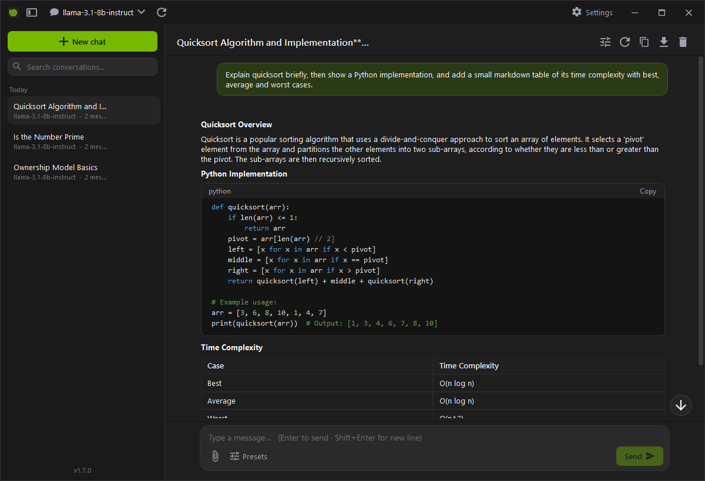
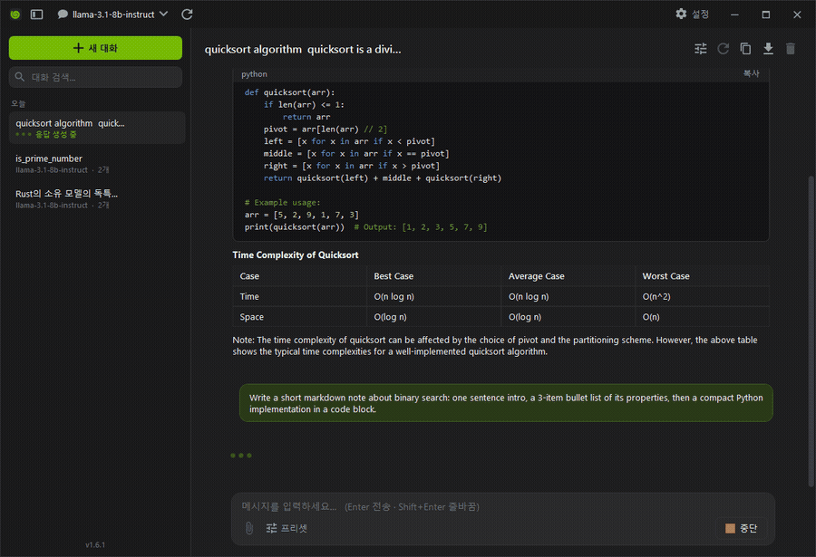

<div align="center">

# NvChat

**A Windows desktop app to chat with the free LLMs on [build.nvidia.com](https://build.nvidia.com)**

Streaming chat · saved conversations · live markdown/code rendering · reasoning display · image attachments · in-app auto-update — ships as a single `.exe`

**English** · [한국어](README.ko.md)

[](https://github.com/akon47/NvChat/actions/workflows/build.yml)
[](https://github.com/akon47/NvChat/releases/latest)
[](https://github.com/akon47/NvChat/releases)
[](https://github.com/akon47/NvChat/stargazers)
[](LICENSE)




<br>



<sub>Markdown renders live as the answer streams in.</sub>

</div>

---

## ✨ Features

- **Model picker** — loads the live model list via `/v1/models` (falls back to a curated list on failure)
- **Streaming chat** — real-time token streaming with an instant **Stop** button
- **Live markdown while streaming** — formatting renders as the answer arrives (like Claude / ChatGPT), not only when it finishes
- **Reasoning display** — collapsible thinking for models that emit `reasoning_content` / `<think>` (deepseek-r1, etc.); inline `<think>` is split out live while streaming
- **Response versions** — regenerating or editing never destroys the previous answer: flip between versions with `‹ 2 / 3 ›`, each keeping the conversation that followed it
- **Parallel conversations** — start a reply in one conversation and keep chatting in another; each streams independently
- **Image attachments (vision)** — attach images to ask vision models (llama-3.2-vision, etc.); large images are auto-downscaled
- **In-app auto-update** — checks GitHub Releases, downloads the new `.exe`, verifies its SHA-256, and swaps itself in place (single-file friendly, no installer). If the checksum can't be verified, nothing is replaced
- **Per-conversation usage** — tracks requests and prompt/completion tokens **per model**, so you can see what each model spent in a conversation (even across mid-chat model switches). Each answer also shows which model wrote it, how long it took and its tokens/sec
- **Context limit** — when a long conversation would overflow the model's context window, the oldest messages are left out of the request (the saved conversation is untouched) and you're told how many
- **Desktop launcher** — a global hotkey (default `Ctrl+Shift+Space`, any combination you press in Settings) pops a **quick-chat mini window** from anywhere + **system tray** (close minimizes to tray), optional **start with Windows**, and a notification when a reply finishes while you're looking elsewhere
- **Personalization** — **custom instructions** (about you / response style) applied to every chat + reusable **prompt presets**
- **Searchable model picker** — filter 100+ models by typing
- **Message actions** — **regenerate** a response, **edit & resend** a user message, **delete** (with **undo**) or **copy** individual messages; a failed request can be **retried** from the banner (with a countdown when rate-limited)
- **Selectable markdown** — headings/nested & numbered lists (with code blocks inside items)/task lists/quotes/**tables**/links & bare URLs, **math** (`$…$`, `\(…\)`, `$$…$$` shown as readable Unicode), **syntax-highlighted code blocks** (language-aware, with copy and wrap toggles); all message text is drag-selectable
- **Safe links** — only `http(s)`/`mailto` links in model output are clickable; `file:`, UNC and custom-protocol links are shown as plain text
- **Find in conversation** — `Ctrl+F` highlights matches and steps through them
- **Conversation management** — sidebar **search** across all conversations, **date groups** (Today/Yesterday/…), **pin**, **rename**, autosave, model-generated **auto titles**, per-conversation **drafts**, delete with **undo**
- **Per-conversation settings** — system prompt, Temperature/Top P/Max Tokens/Penalties
- **Export & backup** — copy the whole conversation or save as Markdown (with reasoning and images); back up all conversations to a JSON file and import them back
- **Image paste & drop** — paste a screenshot with `Ctrl+V` or drop image files anywhere in the chat area
- **Quality of life** — right-click menu on conversations (pin · rename · delete), toast feedback for copy/export, dismissible status banner, scroll-to-bottom button, remembers window size/position, collapsible sidebar, a full set of keyboard shortcuts (listed in Settings), first-time tray hint, periodic update checks
- **Safe storage** — API key encrypted with Windows DPAPI (masked in Settings), one file per conversation written atomically in the background, corrupt files kept aside instead of deleted
- **Multi-language** — English & Korean UI, switchable in Settings (defaults to your Windows language on first run)
- **Themes & accessibility** — **dark / light / high-contrast** (or follow Windows), **zoom** 80–160% (`Ctrl+=` / `Ctrl+-`), screen-reader names on icon buttons, every action reachable by keyboard
- **UI** — custom title bar with DWM rounded corners, Windows 11 snap layouts and a keyboard focus ring; NVIDIA-green accent; ChatGPT/Claude-style layout (bubble only on your messages); resizable, auto-collapsing sidebar; smooth scrolling and transitions; themed dialogs, menus and tray menu throughout

## 📦 Download

Grab the single `NvChat.exe` from [**Releases**](https://github.com/akon47/NvChat/releases/latest) and run it.
It's a self-contained single file that runs even without the .NET runtime installed. (Windows x64)

> **First run:** the app isn't code-signed, so Windows SmartScreen may show a blue "Windows protected your PC" prompt. Click **More info → Run anyway**.

> Once you're on a build with auto-update, new versions are offered inside the app — no need to re-download manually.

## 🔑 Get an API key

1. Sign in to [build.nvidia.com](https://build.nvidia.com)
2. On any model page, click **Get API Key** to create an `nvapi-...` key
3. Paste it into the **Settings** window on first launch (or the ⚙ button), then **Test connection → Save**

> The key is stored **only on this PC + this Windows account**, encrypted with DPAPI (`%APPDATA%\NvChat\settings.json`). It cannot be decrypted on another PC/account.

## ⌨️ Shortcuts

| Key | Action |
|---|---|
| `Enter` | Send (switchable to `Ctrl+Enter` in Settings) |
| `Shift+Enter` | New line |
| `Ctrl+V` | Paste an image from the clipboard (you can also drop image files onto the chat) |
| `Esc` | Stop generating |
| `Ctrl+N` | New conversation |
| `Ctrl+F` | Find in this conversation |
| `Ctrl+Shift+F` | Search all conversations |
| `F2` | Rename the selected conversation |
| `Ctrl+B` | Toggle sidebar |
| `Ctrl+M` | Open the model picker |
| `Ctrl+R` | Regenerate the last response |
| `Ctrl+Shift+C` | Copy the whole conversation |
| `Ctrl+E` | Export as Markdown |
| `Ctrl+=` / `Ctrl+-` / `Ctrl+0` | Zoom in / out / reset |
| `Ctrl+,` | Settings |
| `Ctrl+Shift+Space` | Quick chat from anywhere (global · configurable) |

## 🛠️ Build from source

```powershell
# Run for development
dotnet run --project NvChat/NvChat.csproj

# Build the single-file release exe
dotnet publish NvChat/NvChat.csproj -c Release
# → NvChat/bin/Release/net10.0-windows/win-x64/publish/NvChat.exe
```

Requires the .NET 10 SDK (Windows).

```powershell
# Unit tests (markdown splitting, syntax highlighting, title cleanup, <think> splitting, context trimming, link safety, …)
dotnet test NvChat.Tests/NvChat.Tests.csproj
```

To try a build without touching your real data, point it at another folder: `$env:NVCHAT_DATA_DIR = "C:\temp\nvchat-test"`.

## 🚀 Releases (automated)

Pushing a `v*` tag triggers a GitHub Actions workflow ([`release.yml`](.github/workflows/release.yml)) that
builds the single `NvChat.exe`, publishes a matching `NvChat.exe.sha256`, and uploads both to that tag's Release.
The app's in-app updater uses that checksum to verify downloads.

```bash
git tag v1.0.0
git push origin v1.0.0
```

## 🧩 Tech

.NET 10 / WPF (`net10.0-windows`), MVVM with the CommunityToolkit.Mvvm source generators (no code-behind event handlers — attached behaviors instead), a custom `WindowView` (WindowChrome dark title bar with DWM rounded corners and Windows 11 snap layouts), swappable dark/light/high-contrast palettes, and a
self-written markdown renderer + syntax highlighter — no external UI libraries. The message list is virtualized and markdown is re-rendered
incrementally (only the blocks that changed), so long conversations and long streaming answers stay responsive.

- Endpoint: `https://integrate.api.nvidia.com/v1` (OpenAI-compatible, configurable in Settings)
- Data: `%APPDATA%\NvChat\` — `settings.json` and `conversations\{id}.json` (one file per conversation). A `conversations.json` from 1.8 or earlier is migrated on first run and kept as `conversations.legacy.json`.
- The free tier has rate limits — on HTTP 429 the banner shows when you can retry.

## 📄 License

[MIT](LICENSE) — free to use, modify, and distribute.
